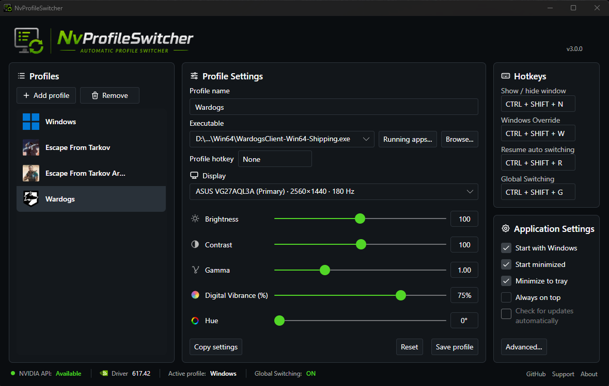
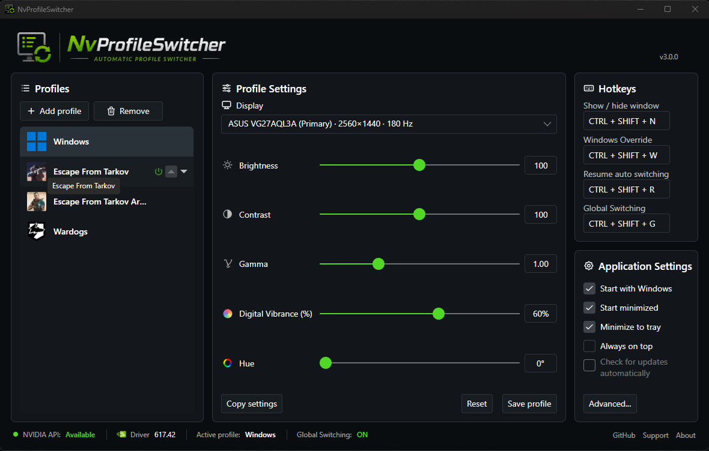
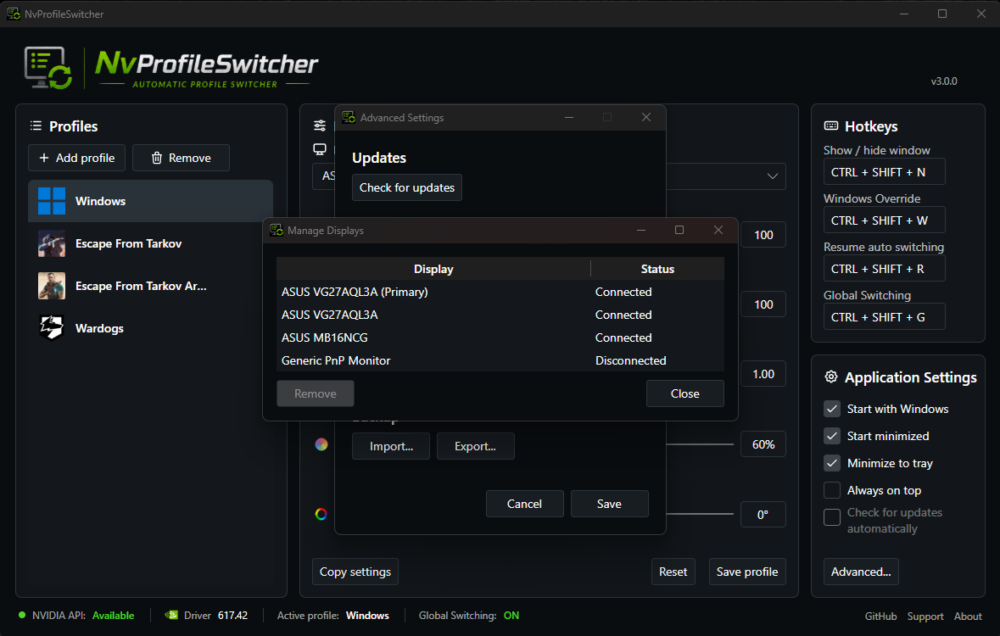
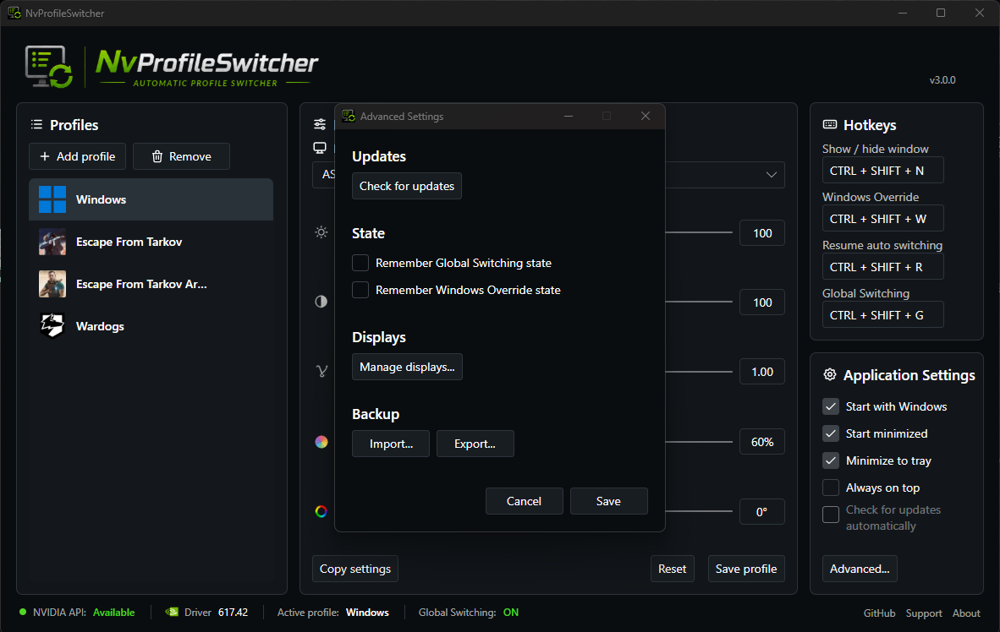

<div align="center">

# NvProfileSwitcher

### Your display. Your colors. Your rules.

**Automatic NVIDIA color profiles for Windows — tailored to every game, app, and monitor.**

Set your favorite colors once. NvProfileSwitcher takes care of the rest.

[**Download**](https://github.com/mgcarnevali/NvProfileSwitcher/releases) · [**Report an issue**](https://github.com/mgcarnevali/NvProfileSwitcher/issues) · [**Support development**](https://ko-fi.com/mgcarnevali)

**Windows 10 / 11** · **NVIDIA GPU** · **Freeware**

</div>

> [!NOTE]
> **NvProfileSwitcher v3 is in development.** Downloads will be available on the releases page when v3 is released.

<div align="center">
  
</div>

## Made for every game and app

Every game and application looks different. Your display settings should adapt automatically.

NvProfileSwitcher watches which application is in the foreground and applies the color profile you've configured for it. Switch between games, work apps, and the desktop — your colors follow you automatically. Prefer manual control? Activate a profile with a hotkey whenever you want.

## Highlights

| Feature | What it does |
|---|---|
| **Automatic application switching** | Detects the foreground application and activates the first matching, enabled profile. |
| **Five NVIDIA color controls** | Adjust **Digital Vibrance, Hue, Brightness, Contrast, and Gamma** independently for each monitor. |
| **NVIDIA settings import** | Initializes newly detected monitors from available NVIDIA Control Panel brightness, contrast, and gamma settings. |
| **Per-monitor settings** | Save distinct colors for each physical display in every profile. |
| **Live Preview** | See adjustments immediately without committing them until you save. |
| **Multiple executables per profile** | Associate several `.exe` names with one profile and use profile order to set priority. |
| **Global Switching** | Pause or resume automatic switching without removing your profiles. |
| **Manual overrides and hotkeys** | Force your Windows colors or a specific application profile, then return to automatic switching. |
| **Display awareness** | Recognizes monitor connections, disconnections, and known display identities. |
| **Sleep and hibernation recovery** | Refreshes NVIDIA and display state and reapplies the appropriate colors after Windows resumes. |
| **Portable and installed editions** | Choose a standalone executable or a conventional Windows installer. |
| **Built-in updates and backups** | Check for updates, verify downloads, and export or import your configuration. |

## How automatic switching works

1. **Configure your Windows Profile.** This is your baseline for the desktop and any application without a matching profile.
2. **Create an Application Profile.** Give it a name and select an executable using **Running apps...** or **Browse...**.
3. **Adjust each display.** Select a monitor, tune its colors, and preview changes in real time.
4. **Save profile.** When a matching application comes to the foreground, NvProfileSwitcher applies its saved colors automatically.
5. **Switch away.** The next matching application gets its own profile; otherwise, your Windows Profile returns.

### One profile, multiple applications

You can attach more than one executable to a profile. Matching uses the executable **filename**, case-insensitively, rather than its full path. If multiple enabled profiles match, **the first profile in the list wins**. Use the up/down controls to change priority.

For example, one profile can cover several creative applications that share your preferred color settings, while another profile gives a particular game a more vibrant look.

## Profiles and editing

### Windows Profile

Your always-available baseline profile. It is the first entry in the list and cannot be removed. NvProfileSwitcher applies it when no application profile matches, when Global Switching is off, when Windows Override is active, and when the application exits.

New profiles start with your Windows Profile's color settings for the connected displays, so you can fine-tune only what needs to change.

<div align="center">
  
</div>

### Application Profiles

Each application profile has its own name, executable associations, enabled state, optional hotkey, and color settings for every monitor.

- **Add profile** creates a new profile to configure.
- **Running apps...** lets you choose from detected running applications; **Browse...** selects an executable on disk.
- **Enable/disable** using the power button beside a profile determines whether it participates in automatic switching and manual activation.
- **Move up/down** changes matching priority.
- **Copy settings** copies color settings from another profile for displays shared by both.
- **Reset to NVIDIA defaults** returns the selected monitor's controls to neutral values (100 brightness, 100 contrast, 1.00 gamma, 50% Digital Vibrance, and 0° hue), not the values imported on first detection.
- **Save profile** commits your edits; **Cancel** discards them. NvProfileSwitcher asks before discarding unsaved changes.

### Color controls

Every control is configured **per profile, per monitor**.

| Control | Range | Neutral value |
|---|---:|---:|
| Brightness | 80–120 | 100 |
| Contrast | 80–120 | 100 |
| Gamma | 0.30–2.80 | 1.00 |
| Digital Vibrance | 0–100% | 50% |
| Hue | 0–359° | 0° |

All five controls are applied through NVIDIA interfaces. **Digital Vibrance and Hue** use NVAPI color controls; **Brightness, Contrast, and Gamma** use NVIDIA's target gamma functionality.

### Live Preview

Move a slider and see the result immediately on the selected monitor. Changes remain a draft until you select **Save profile**. When the editor loses focus, is minimized, or is hidden, the temporary preview gives way to the currently active saved profile; returning to the editor restores the preview when applicable.

This lets you experiment without permanently changing the profile you're using.

## Automatic switching, Global Switching, and overrides

These controls serve different purposes:

| Control | Behavior |
|---|---|
| **Global Switching: ON** | Automatically follows the foreground application, unless a manual override is active. |
| **Global Switching: OFF** | Stops application-based switching and applies the Windows Profile. |
| **Windows Override** | Temporarily forces the Windows Profile even when another application is active. |
| **Application profile hotkey** | Temporarily forces that enabled profile, regardless of the foreground application. |
| **Resume auto switching** | Clears a manual override and returns control to automatic detection. |

Pressing the same override hotkey again returns to automatic switching. The status bar identifies the active profile and shows **(override)** when one is in effect.

In **Advanced Settings**, you can choose whether NvProfileSwitcher remembers the Global Switching state and Windows Override state between launches.

## Keyboard shortcuts

Assign global shortcuts in **Hotkeys**, and individual application shortcuts in **Profile Settings**.

| Shortcut action | Purpose |
|---|---|
| **Show / hide window** | Show or hide NvProfileSwitcher. |
| **Global Switching** | Toggle automatic application switching. |
| **Windows Override** | Toggle the Windows Profile override. |
| **Resume auto switching** | Clear the current override. |
| **Profile hotkey** | Toggle a specific enabled application profile override. |

Click a hotkey field and press your desired combination. Press **Esc** to clear it. Shortcuts generally require Ctrl or Alt plus another key; **F1–F24** can be used alone. **Ctrl+Alt without Shift** is reserved to avoid conflicts with AltGr; the Windows key is not supported as a modifier. Duplicate or already-registered shortcuts are rejected. No default shortcuts are assigned.

## Multiple monitors

NvProfileSwitcher stores separate colors for each display and profile. Where available, it uses a unique **EDID serial number** to recognize a physical monitor even if Windows changes its display number or connection. Displays without unique serial numbers are tracked by their connection, with safeguards for ambiguous identities.

When a monitor is detected for the first time, NvProfileSwitcher initializes its Windows Profile with available NVIDIA Control Panel **Brightness, Contrast, and Gamma** settings, and reads **Digital Vibrance and Hue** from the current NVIDIA driver values. If valid settings cannot be read, neutral defaults are used for the affected controls. Per-channel (R/G/B) adjustments are not imported.

This initialization happens only once per monitor; subsequent changes in NVIDIA Control Panel are not automatically synchronized.

Existing saved monitor settings are preserved. Newly created application profiles inherit their initial colors from the Windows Profile. Connection and disconnection events refresh the display setup automatically.

Use **Advanced Settings → Manage displays...** to review saved displays and remove disconnected displays you no longer use.

<div align="center">
  
</div>

## Recovery after sleep or hibernation

When Windows resumes, NvProfileSwitcher refreshes the NVIDIA API and monitor information, then reapplies the appropriate colors — whether you're using an application profile, Windows Profile, or Live Preview. No manual profile selection is required.

## System tray and startup

NvProfileSwitcher can run conveniently alongside your other applications:

- **Start with Windows** launches it when you sign in.
- **Start minimized** starts it hidden in the system tray when launched with Windows.
- **Minimize to tray** hides the window instead of keeping it on the taskbar when minimized.
- **Always on top** keeps the main window above other windows.

While NvProfileSwitcher is hidden in the system tray, its icon menu provides **Open NvProfileSwitcher**, **Global Switching**, **Check for updates**, **About NvProfileSwitcher**, and **Exit**. Clicking the tray icon reopens the window.

**Closing the window with X exits NvProfileSwitcher** and restores the Windows Profile. Use minimize-to-tray when you want the application to keep running out of sight.

## Advanced Settings

Manage update checks, remember switching and override states, organize saved displays, and import or export your configuration.

<div align="center">
  
</div>

## Updates, configuration, and backups

### Updates

Use **Check for updates** from the application or tray menu, or enable **Check for updates automatically** in Application Settings. When a new stable release is available, NvProfileSwitcher offers to install it or postpone it.

Downloads are checked against their **SHA-256** verification files. The updater supports both the installed edition and the portable executable.

### Backup and restore

**Export** saves a copy of your configuration, including profiles, settings, and hotkeys. **Import** restores a previously exported v3 configuration, replacing the current settings after confirmation.

The active configuration is stored locally at:

```text
%APPDATA%\NvProfileSwitcher\config.json
```

## Download and installation

Get official builds from [**GitHub Releases**](https://github.com/mgcarnevali/NvProfileSwitcher/releases).

| Windows installer | Portable ZIP |
|---|---|
| Install and uninstall through Windows as usual. | Extract the ZIP and run `NvProfileSwitcher.exe`. |
| Suitable for a standard desktop installation. | Suitable when you prefer not to install the application. |

**Requirements:** Windows 10 or Windows 11, 64-bit (x64), a compatible NVIDIA GPU, and an NVIDIA display driver. The v3 executable is self-contained; **no separate .NET runtime installation** is needed.

## Frequently asked questions

**Does NvProfileSwitcher work with applications other than games?**  
Yes. Profiles can be associated with any supported Windows executable, including productivity and creative applications.

**Can I use different colors on two monitors?**  
Yes. Every profile can store independent settings for each recognized monitor.

**What happens when I leave a game?**  
NvProfileSwitcher activates the profile matching the new foreground application, or the Windows Profile if there is no match.

**Can I temporarily force one profile?**  
Yes. Assign a profile hotkey, use Windows Override, or select Resume auto switching to return to automatic detection.

**Can I keep the app running without a visible window?**  
Yes. Enable Minimize to tray, or Start minimized when launching with Windows.

**What if a feature doesn't work on my system?**  
[Open an issue](https://github.com/mgcarnevali/NvProfileSwitcher/issues) with your Windows version, NVIDIA GPU and driver, and steps to reproduce the problem.

## Feedback and support

Found a bug or have a feature request? [**Open a GitHub issue**](https://github.com/mgcarnevali/NvProfileSwitcher/issues).

If you'd like to support continued development, visit [**Ko-fi**](https://ko-fi.com/mgcarnevali).

## Freeware

**NvProfileSwitcher is free to use.**

Copyright © 2026 Maximiliano Carnevali. All rights reserved.

---

<div align="center">

**Your display. Your colors. Your rules.**

*NvProfileSwitcher is an independent project and is not affiliated with, endorsed by, or sponsored by NVIDIA Corporation. NVIDIA is a trademark of NVIDIA Corporation.*

</div>
